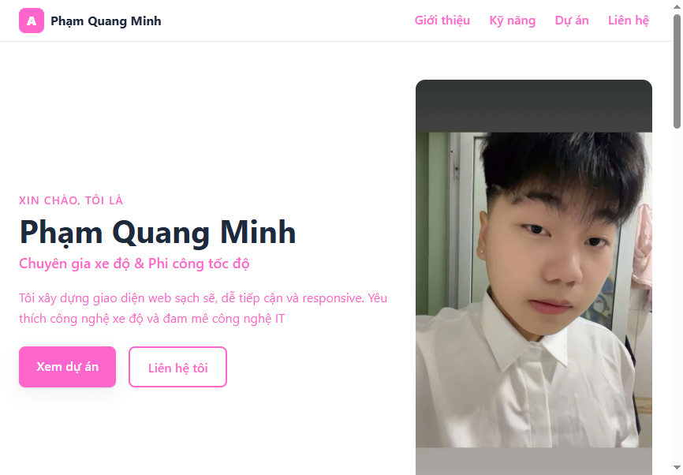
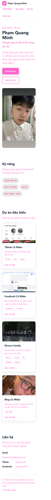

# BÁO CÁO KIỂM THỬ

## 1. Thông tin chung

| Hạng mục | Chi tiết |
|---|---|
| Dự án | Portfolio cá nhân – Phạm Quang Minh |
| Ngày kiểm thử | 27/10/2026 |
| Phạm vi | Trang tĩnh HTML/CSS, tài nguyên ảnh, điều hướng và bố cục responsive |
| Môi trường | Trình duyệt tích hợp trong VS Code; mở trang từ tệp `index.html` |

Đây là kiểm tra thủ công trên phiên bản mã nguồn hiện tại, không thay thế cho kiểm thử trên mọi trình duyệt, trình xác thực HTML, công cụ quét bảo mật hoặc môi trường hosting thực tế.

## 2. Kết quả theo tiêu chí

| # | Tiêu chí | Kết quả | Tóm tắt |
|---|---|---|---|
| 1 | Tính đúng đắn | Đạt có lưu ý | Các mục nội dung, ảnh và điều hướng chính hoạt động; hai liên kết dự án vẫn là liên kết mẫu. |
| 2 | UI/UX | Đạt có lưu ý | Bố cục thích ứng ở ba kích thước đã thử; màu chữ hồng trên nền trắng có độ tương phản thấp. |
| 3 | Khả năng vận hành - xử lý lỗi | Đạt có lưu ý | Trang và tài nguyên cục bộ tải được; không có luồng nghiệp vụ động để kiểm tra xử lý lỗi. |
| 4 | Bảo mật | Đạt trong phạm vi rà soát tĩnh | Phạm vi mã được kiểm tra chỉ gồm HTML/CSS tĩnh; chưa thực hiện quét bảo mật hoặc đánh giá cấu hình hosting. |
| 5 | Chất lượng mã nguồn | Cần cải thiện | Có tách HTML/CSS và dùng bố cục responsive; danh sách kỹ năng thiếu thẻ đóng `</ul>`. |
| 6 | Khả năng triển khai | Đạt một phần | Mở trực tiếp từ tệp cục bộ thành công; chưa xác minh triển khai qua HTTP, Docker hoặc hosting thật. |

## 3. Chi tiết kiểm thử

### 3.1 Tính đúng đắn

- Mở trang thành công; tiêu đề trang và các mục giới thiệu, kỹ năng, dự án, liên hệ hiển thị.
- Tất cả 5 ảnh được tham chiếu trong trang đã tải thành công trên trình duyệt.
- 4 thẻ dự án được hiển thị.
- Thử bấm điều hướng **Dự án** và **Liên hệ**; URL lần lượt chuyển tới `#projects` và `#contact`.
- Còn 2 liên kết dự án có `href="#"`; các liên kết này chưa dẫn tới trang đích thực tế.

**Đánh giá:** Các chức năng cốt lõi có thể kiểm tra trên trang tĩnh hoạt động. Cần thay các URL mẫu trước khi xem toàn bộ liên kết dự án là hoàn chỉnh.

### 3.2 UI/UX

- Đã kiểm tra bố cục tại các viewport 390 px, 768 px và 1280 px.
- Lưới dự án lần lượt hiển thị 1, 2 và 3 cột; không phát hiện tràn ngang tại các kích thước đã thử.
- Ảnh desktop ghi lại thanh điều hướng và phần giới thiệu; ảnh mobile chụp toàn trang, bao gồm kỹ năng, dự án và liên hệ.
- Màu chữ phụ `#FF66CC` trên nền trắng có độ tương phản xấp xỉ **2,6:1**. Màu này có thể gây khó đọc và thấp hơn mốc WCAG AA 4,5:1 dành cho văn bản thông thường. Chưa thực hiện đánh giá tiếp cận toàn diện.

**Ảnh minh chứng** (chụp trực tiếp từ trang đang chạy trong trình duyệt):

**Desktop**

**Mobile**

### 3.3 Khả năng vận hành - xử lý lỗi

- Trang mở trực tiếp từ `index.html`; CSS và ảnh dùng đường dẫn tương đối và tải được trong lần kiểm tra.
- Dự án không có backend, biểu mẫu gửi dữ liệu hoặc chức năng JavaScript động; vì vậy không có luồng gửi dữ liệu hay phản hồi lỗi máy chủ để kiểm thử.
- Chưa thử tình huống thiếu tài nguyên, mất kết nối tới dịch vụ bên ngoài hoặc lỗi trên các trình duyệt khác.

**Đánh giá:** Hoạt động cơ bản ở chế độ tệp cục bộ đã được xác nhận. Khả năng phục hồi khi lỗi và hành vi trên các môi trường khác chưa được xác minh.

### 3.4 Bảo mật

- Trong phạm vi rà soát, dự án là trang HTML/CSS tĩnh; không thấy mã JavaScript, endpoint xử lý dữ liệu hay cấu hình bí mật cần thiết để chạy trang.
- Trang có liên kết tới TikTok và Facebook; đây là các đích bên ngoài website.
- Không chạy công cụ quét lỗ hổng, không đánh giá header bảo mật, HTTPS, cấu hình máy chủ hoặc dịch vụ bên thứ ba.

**Đánh giá:** Chưa có dấu hiệu rủi ro phía máy chủ trong phần mã tĩnh đã xem; kết quả này không phải chứng nhận an toàn cho môi trường triển khai.

### 3.5 Chất lượng mã nguồn

- HTML và CSS được đặt trong các tệp riêng; CSS có breakpoint cho mobile, tablet và desktop.
- Có sử dụng các vùng nội dung HTML có ý nghĩa và thuộc tính `alt` cho ảnh.
- Thẻ `<ul class="skill-grid">` trong `index.html` không có thẻ đóng `</ul>` trước khi kết thúc phần kỹ năng. Trình duyệt vẫn hiển thị nội dung, nhưng cần sửa markup để bảo đảm cấu trúc HTML đúng.
- Chưa chạy HTML validator, CSS validator, linter hoặc bộ kiểm thử tự động.

**Đánh giá:** Cấu trúc dễ theo dõi ở mức cơ bản; cần sửa markup và chạy validator trước khi phát hành.

### 3.6 Khả năng triển khai

- Xác nhận trang có thể mở trực tiếp từ tệp cục bộ và tải được tài nguyên ảnh/CSS.
- README có hướng dẫn chạy máy chủ tĩnh bằng Python và Docker/Nginx; các phương thức này chưa được chạy thử trong lần kiểm tra.
- Chưa kiểm tra trên hosting thật, tên miền/HTTPS, cache, cấu hình triển khai hoặc khả năng tương thích giữa các trình duyệt.

**Đánh giá:** Có thể xem trước trực tiếp; trạng thái triển khai qua máy chủ hoặc hosting vẫn chưa được xác minh.

## 4. Tệp minh chứng

- [Ảnh giao diện desktop](screenshots/01-desktop.png)
- [Ảnh giao diện mobile](screenshots/02-mobile.png)